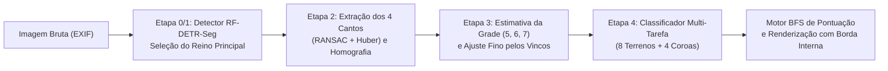

# Arquitetura, Metodologia e Especificação Técnica — Pontuador de Kingdomino (PPGT13007)

## 1. Objetivo do Projeto
Desenvolver uma aplicação completa de Visão Computacional para julgar e contabilizar automaticamente a pontuação final de tabuleiros (reinos) do jogo de tabuleiro **Kingdomino** a partir de fotografias reais capturadas por dispositivos móveis (incluindo execução embarcada via ONNX Runtime Mobile em Android ARM64).

O projeto atende às categorias de **Detecção/Segmentação de Objetos** e **Classificação de Imagens** da disciplina de Visão Computacional (`PPGT13007`), priorizando uma arquitetura aberta com licença compatível para uso comercial (Apache 2.0 / BSD / MIT), leve e reprodutível tanto em CPU/GPU local quanto em Google Colab Pro (T4 / L4).

---

## 2. Regras de Pontuação do Kingdomino Implementadas (`src/pontuacao.py`)
- **Dimensões suportadas:** grade padrão $5 \times 5$ (25 células), grades parciais/retangulares ($5 \times 6$, $6 \times 6$) e variante duelo $7 \times 7$ (49 células), incluindo tabuleiros incompletos com espaços vazios (`"vazio"`).
- **Cálculo de propriedades:** agrupamento de terrenos adjacentes ortogonalmente via busca em largura (BFS). Cada território conexo pontua:
  $$\text{pontos da região} = \text{quantidade de quadrados} \times \text{total de coroas na região}$$
- **Terrenos suportados (8 classes):** `castelo`, `deserto`, `floresta`, `mineracao`, `oceano`, `pantano`, `planicie` e `vazio`.
- **Coroas por célula (4 classes):** `0`, `1`, `2` ou `3` coroas (`castelo` e `vazio` possuem sempre `0` coroas).
- **Bônus configuráveis:**
  - **Harmonia (+5 pontos):** concedido se não houver nenhuma célula `"vazio"` na matriz do reino.
  - **Reino do Meio (+10 pontos):** concedido se o `"castelo"` estiver na posição central da grade.

---

## 3. Pipeline Técnico Ponta a Ponta (`src/pipeline_pontuacao.py`)

### Etapa 0 e Etapa 1 — Segmentação e Seleção do Reino Principal (`src/geometria.py`)
- Utiliza o detector de segmentação de instâncias `RF-DETR-Seg` (`RFDETRSegNano` / `RFDETRSegSmall`, `num_classes=1`) com pesos em `modelos/detector_tabuleiro_rfdetr.pth` (mantido em cache em memória).
- Extrai as máscaras binárias de todos os tabuleiros detectados na mesa e ranqueia cada candidato combinando **maior área relativa da máscara (60%)** e **proximidade ao centro-inferior da imagem (40%)** (ponto de referência relativo `(0.5, 0.9)`).
- Elege o primeiro colocado como `reino_principal` e classifica os demais tabuleiros de outros jogadores como `reino_ignorado`.

### Etapa 2 — Extração Robusta dos 4 Cantos e Homografia Proporcional (`src/geometria.py`)
- Simplifica a envoltória convexa da máscara a um quadrilátero inicial por busca binária em `cv2.approxPolyDP` (`simplificar_para_quadrilatero`) e ordena os vértices no sentido horário (`TL, TR, BR, BL` / `SE, SD, ID, IE`) por ângulo polar (`ordenar_vertices`), evitando colapso em rotações de ~45°.
- Amostra pontos densos ao longo do **contorno real** da máscara (descartando 12% nas quinas) e ajusta uma reta 2D por lado via **RANSAC** (`limiar_distancia=2.5`, `iteracoes=150`, semente `42` e refinamento `cv2.DIST_L2` nos inliers) para ignorar saliências do castelo 3D ou meeples.
- Aplica trava de consistência projetiva (tolerância de `15°` em relação ao lado correspondente do quadrilátero base, com fallback `cv2.DIST_HUBER`) e obtém os 4 cantos finais pela interseção das retas adjacentes.
- Combina gradiente direcional Sobel (`cinza` + canal `L` do espaço LAB) com transformação morfológica **Black-Hat** (kernels finos `1x5` e `5x1`) ponderada pela taxa de continuidade transversal (`_calcular_perfil_vincos`) para estimar a dimensão da grade (`5`, `6` ou `7`) após homografia preliminar (`980x980`).
- Aplica `cv2.warpPerspective` gerando a imagem retificada final com resolução proporcional (`colunas * 200`, `linhas * 200`), garantindo células quadradas de `200x200` pixels.

### Etapa 3 — Ajuste Fino das Linhas de Corte e Fatiamento (`src/geometria.py`)
- `calcular_linhas_corte_ajustadas` busca o pico real do vinco físico dentro de uma janela de $\pm 5\%$ ao redor de cada posição teórica (exigindo proeminência $\ge 1.35\times$ a média local da janela e interpolando divisórias suaves), corrigindo pequenas derivas de perspectiva.
- `fatiar_grade` recorta cada célula aplicando margem interna (`4 px` para treino / `0 px` para inferência direta) e redimensiona para `160x160` RGB normalizado pelos parâmetros ImageNet (`MEDIA_IMAGENET = [0.485, 0.456, 0.406]`, `DESVIO_IMAGENET = [0.229, 0.224, 0.225]`).

### Etapa 4 — Classificação Multi-Tarefa de Células (`src/classificador.py`)
- `ClassificadorCelulasKingdomino`: rede leve multi-tarefa (`mobilenet_v3_small`, `efficientnet_b0` ou `convnext_atto`) com extrator compartilhado e duas cabeças lineares paralelas (`cabeca_terreno` com 8 saídas e `cabeca_coroas` com 4 saídas).
- Aplica regra de domínio pós-inferência: células preditas como `"castelo"` ou `"vazio"` têm a contagem de coroas fixada em `0`.
- Na renderização final (`desenhar_resultado_pontuacao`), o contorno colorido de cada território conexo é desenhado na **extremidade interna** de cada célula (`recuo_borda`), evitando que regiões adjacentes sobrescrevam as linhas divisórias umas das outras.

---

## 4. Dataset V2, Ferramentas de Rotulagem e Diagnóstico de Paridade Mobile

### 4.1 Expansão e Saneamento da Base (`scripts/preparar_dataset_v2.py` e `dados/manifesto_dataset_v2.json`)
- **Base Unificada (85 imagens brutas):**
  - `lote_01` (`dados/fotos_brutas/`): 50 imagens originais com anotações de segmentação COCO (`dados/tabuleiro_coco/`).
  - `lote_02` (`dados/fotos_brutas_02/`): 35 novas fotos de tabuleiros reais deduplicadas por hash SHA-256, pré-rotuladas automaticamente pelo pipeline e revisadas manualmente na interface web.
- **Divisão Estrita por Tabuleiro (`treino` vs. `validacao`):**
  - `66` tabuleiros válidos de treino (`1.781` células) e `16` tabuleiros válidos de validação (`459` células), totalizando **`82` tabuleiros com células válidas** e **`2.240` células saneadas** em `dados/dataset_celulas/rotulos_celulas.csv` (zero vazamento de tabuleiro/iluminação entre treino e validação).

### 4.2 Ferramentas Visuais e Diagnóstico JSON por Etapa (`ferramentas/`)
- **Rotulador e Avaliador Web (`ferramentas/rotulador_web/servidor.py`):** interface FastAPI com 3 abas (*Rotulagem*, *Ajustes Geométricos*, *Avaliar Foto*) e exportação de diagnóstico JSON das **Etapas 1 a 4** (`diagnostico_etapa1..4_python.json`) para validação de paridade bit a bit com o aplicativo mobile.
- **Avaliador Desktop (`ferramentas/avaliador_desktop.py`):** interface Tkinter para inspeção local das etapas intermediárias e exportação dos JSONs de diagnóstico.

### 4.3 Exportação ONNX para Mobile (`scripts/exportar_modelos_mobile.py` e `modelos/mobile/`)
- **Detector (`detector_tabuleiro_rfdetr_fp16.onnx` / `melhor_detector_fase2_fp32.onnx`):** exportado em ONNX `opset_version=17` com `dynamo=False`.
- **Classificador (`classificador_celulas_fp32.onnx`):** exportado em precisão total **FP32** (`~3,57 MB`, entrada dinâmica `"imagem"` `[lote, 3, 160, 160]` e saídas `["logits_terreno", "logits_coroas"]`), evitando o estouro numérico (*overflow*) das ativações `Hardswish` do `MobileNetV3-Small` em `FP16` no runtime ARM64 do Android.

---

## 5. Auditoria e Métricas Congeladas do Baseline (`C0` e `D0`)

Geradas por `scripts/minerar_erros_base.py` e congeladas em `dados/metricas_baseline_c0_d0.json`, `dados/relatorio_erros_baseline.json` e `dados/prancha_erros_baseline.png`:

| Métrica Baseline | Validação (`16` tabuleiros / `459` células) | Base Completa (`85` fotos / `82` tabuleiros / `2.240` células) |
| :--- | :---: | :---: |
| **Detector (`D0`) — Taxa de Detecção** | **100,00%** (`16/16`) | **98,82%** (`84/85`) |
| **Detector (`D0`) — IoU Médio da Máscara (vs. COCO)** | **0,9801** | **0,9747** |
| **Detector (`D0`) — Erro Médio dos 4 Cantos (px)** | **3,13 px** | **3,62 px** |
| **Classificador (`C0`) — Acurácia Terreno (8 classes)** | **98,04%** | **98,88%** |
| **Classificador (`C0`) — F1-Macro Terreno (8 classes)** | **0,9516** | **0,9724** |
| **Classificador (`C0`) — Acurácia Coroas (4 classes)** | **98,69%** | **99,20%** |
| **Classificador (`C0`) — F1-Macro Coroas (4 classes)** | **0,9363** | **0,9765** |
| **Classificador (`C0`) — Acurácia Célula Exata** | **97,17%** | **98,35%** |
| **Taxa de Tabuleiros 100% Perfeitos** | **43,75%** (`7/16`) | **68,29%** (`56/82`) |

**Diagnóstico dos Erros do Baseline (`C0`):**
1. **Oclusão por torre 3D do castelo (`vizinha_ao_castelo`):** principal fonte de erro — a torre cartonada 3D invade visualmente a célula vizinha superior (`[1, 2]`), induzindo predição de `castelo`.
2. **Reflexo especular / flash (`confusao_com_fundo_vazio`):** brilho intenso sobre o verniz da peça confundido com `vazio`.
3. **Contagem de coroas (`erro_contagem_coroa`):** confusão em classes raras (`2c` e `3c`).

---

## 6. Metodologia de Otimização em Duas Fases (Google Colab Pro + Optuna)

### 6.1 Fase 1 — Fine-Tuning e Otimização do Classificador Multi-Tarefa (`notebooks/01_fase1_classificador_optuna.ipynb`)
- **Augmentation Físico Direcionado:**
  - *Simulação de Oclusão por Torre 3D do Castelo (25%):* sobrepõe na borda inferior (`20%` a `35%` da altura) recortes reais de células de `castelo` do conjunto de treino.
  - *Simulação de Reflexo Especular / Flash (20%):* mancha elíptica Gaussiana de alto brilho.
  - *Variações Geométricas e de Luz:* rotações ortogonais (`0°, 90°, 180°, 270°`), deslocamento de recorte (`±6 px`) e brilho/contraste (`±15%`) com matiz fixa em `0`.
- **Balanceamento:** `WeightedRandomSampler` + `CrossEntropyLoss` com pesos inversos à frequência e `label_smoothing`.
- **Busca Optuna (30 trials):** maximiza `0.40 * F1_macro_terreno + 0.45 * F1_macro_coroas + 0.15 * Taxa_Tabuleiros_100_Perfeitos` avaliando `mobilenet_v3_small`, `efficientnet_b0` e `convnext_atto` (`<= 20 MB` em FP32) e exportando `resultados_fase1/melhor_classificador_fase1_fp32.onnx`.

### 6.2 Fase 2 — Fine-Tuning, Redução de Tamanho e Estabilização do Detector (`notebooks/02_fase2_detector_rfdetr.ipynb`)
- **Execução Otimizada para Colab Pro (SSD Local + Persistência no Google Drive):**
  - Copia e extrai `kingdomino_pontuador.v2-v2.coco-segmentation.zip` para `/content/dataset_coco/` no SSD local da máquina virtual e saneia as anotações COCO para manter exatamente 1 categoria alvo (`tabuleiro`) sem polígonos degenerados.
  - Persiste o banco SQLite do Optuna (`estudo_optuna_fase2.db`), checkpoints, modelo ONNX, gráficos (`300 dpi`) e relatório JSON diretamente no Google Drive (`PASTA_SAIDA_DRIVE`).
- **Augmentation Geométrico e Fotométrico Preservando os 4 Cantos:**
  - Escala multi-distância (`0.65x` a `1.15x`), inclinação projetiva leve (`0.02` a `0.06`), rotações ortogonais (`0°, 90°, 180°, 270°`), espelhamento horizontal, variações fotométricas (`±15%`) e sombras suaves, com validação geométrica pós-transformação garantindo que os 4 vértices do polígono do tabuleiro nunca sejam amputados.
- **Busca Optuna Persistente (15 trials):**
  - Maximiza a precisão geométrica dos 4 cantos com meta de tamanho reduzido (`<= 45 MB` em ONNX):
    $$\text{Score}_{\text{Fase2}} = 0.45 \cdot \text{IoU}_{\text{Medio\_Mascara}} + 0.35 \cdot \text{mAP}_{50:95\text{\_Mascara}} + 0.20 \cdot \text{Taxa}_{\text{Cantos\_Precisos\_10px}}$$
  - Explora variantes compactas (`RFDETRSegNano`, `RFDETRSegSmall`, `RFDETRSegMedium`), resoluções múltiplas de `56` (`560` ou `616`), `lr` (`5e-5` a `3e-4`), `weight_decay` (`1e-4` a `1e-2`) e `grad_accum_steps`.
  - Exporta `melhor_detector_fase2_fp32.onnx` (`opset_version=17`, `dynamo=False`) validando ausência de `NaN`/`Inf` e paridade numérica (`erro_max < 1e-3`).

---

## 7. Convenções de Código do Projeto
- **Idioma:** todos os nomes de arquivos, funções, classes, métodos, rotas e variáveis em português (`pt-br`, `snake_case`).
- **Tipagem:** código Python sem marcadores de tipo (*type hints*) nos parâmetros ou retornos das funções.
- **Interface Web:** notificações flutuantes (toasts) e modais customizados, sem uso de `alert`, `confirm` ou `prompt`.
